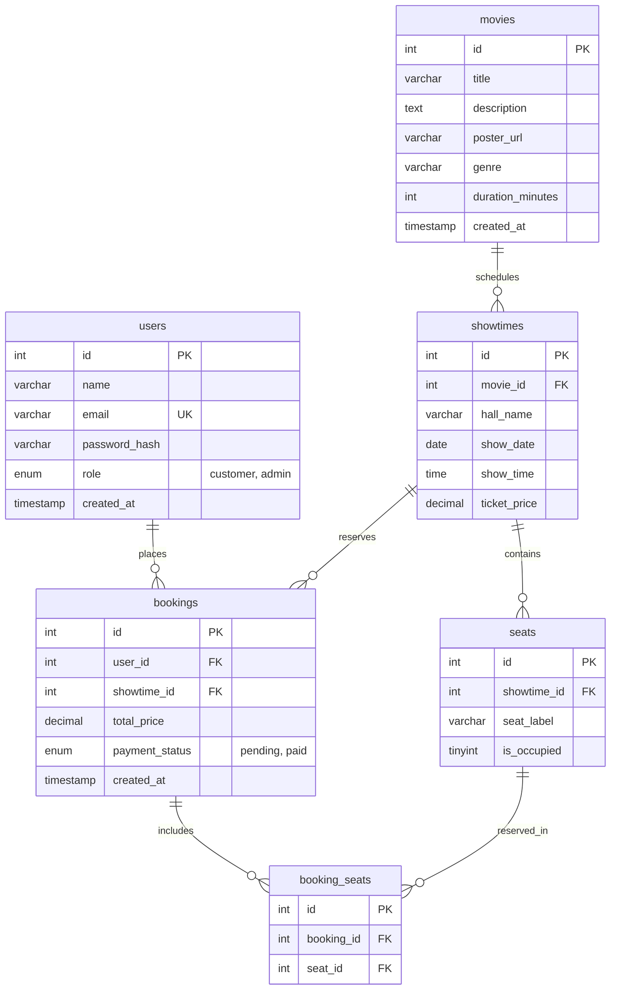

# 🎬 CinemaHub - Next-Gen Movie Ticketing & Cinema Experience


**CinemaHub** is a modern, responsive full-stack Cinema Management & Online Ticket Booking web application. Featuring a dark glassmorphic cinema UI, real-time interactive theater seat selection (Standard & VIP tiers), digital QR-coded e-ticket pass generation, personal booking history, and an administrative movie management dashboard.

---

## ✨ Features

### 1. 🔐 User Registration & Authentication
- **Secure Authentication**: Customer and Administrator sign up and login powered by `bcrypt` password hashing and `JSON Web Tokens (JWT)`.
- **Quick-Fill Demo Mode**: One-click demo buttons on login for instantaneous evaluation (`Test User` and `Admin`).
- **User Profile Menu**: Dynamic avatar badge, role display, navigation links, and logout session handling.

### 2. 🎥 Movie Catalog & Hero Showcase
- **Featured Hero Showcase**: Large cinematic banner highlighting top blockbusters with embedded YouTube trailer preview player and quick-book CTA.
- **Instant Search**: Real-time query search filtering across movie titles, genres, and cast members.
- **Genre Filtering**: Filter pills for *All Genres*, *Action*, *Sci-Fi*, *Drama*, *Animation*, and *Comedy*.
- **Sorting Options**: Sort catalog by *Highest Rated*, *Latest Release*, *Lowest Price*, or *Title (A-Z)*.

### 3. 📅 Movie Details & Showtime Selector
- **Detailed Modal**: High-res poster art, synopsis, age rating badge (`PG-13`, `R`, `PG`), duration, pricing, and starring cast.
- **Showtime Picker**: Multi-day scheduling (*Today*, *Tomorrow*, *Day After*) with time slot buttons (`01:00 PM`, `04:30 PM`, `08:00 PM`, etc.).

### 4. 💺 Interactive Curved-Screen Theater Seat Map
- **Curved Cinema Screen**: Graphic perspective arc with ambient stage lighting simulation.
- **Tiered Seating Grid**:
  - **Standard Seats** (Rows A to D)
  - **VIP Gold Seats** (Rows E & F) with premium surround-sound positioning and surcharge.
- **Real-Time Seat Status**: Clear visual distinctions between *Available*, *Selected*, and *Occupied* seats.
- **Live Price Accumulator**: Dynamic real-time calculation updating seat counts and total price before booking.

### 5. 🎟️ Digital E-Ticket Pass Generation
- **Automated Digital Stub**: Generates an e-ticket receipt containing unique booking references (`#CH-XXXXXX`), customer name, auditorium, showtime, and highlighted seat numbers.
- **SVG QR Code**: Procedurally rendered vector QR code for ticket scanning at cinema entry.
- **Dedicated Print Stylesheet**: Native `@media print` support formatting the receipt cleanly for physical printing or saving as a PDF.

### 6. 📜 Booking History ("My Tickets")
- **Customer Ticket Locker**: Dedicated panel listing all upcoming and past reservations.
- **One-Click Pass Retrieval**: Re-open and print any digital e-ticket pass from your booking history anytime.

### 7. 🛡️ Administrator Management Panel
- **Real-Time Analytics**: Live stat counters for *Active Movies*, *Total Tickets Sold*, and *Gross Revenue*.
- **Add New Movies**: Intuitive form to register new titles, genres, durations, ratings, prices, cast lists, and poster images.
- **Manage Listings**: View current cinema listings and delete expired movies with instant catalog synchronization.

---

## 🛠️ Technology Stack

| Layer | Technologies Used |
| :--- | :--- |
| **Frontend** | HTML5 (Semantic), Modern CSS3 (Dark Glassmorphism, Flexbox, Grid, Print Styles), Vanilla JavaScript (ES6+), FontAwesome 6, Google Fonts (*Outfit* & *Inter*) |
| **Backend** | Node.js, Express.js (v5), RESTful API Architecture |
| **Database** | MySQL (with `mysql2/promise` connection pooling) |
| **Security & Auth** | JWT (`jsonwebtoken`), Password Hashing (`bcrypt`), CORS, Dotenv |
| **State Management** | Hybrid Architecture: Live REST API with fallback to browser `localStorage` |

---

## 📁 Project Structure

```text
CinemaHub/
├── package.json                 # Root project metadata & start scripts
├── README.md                    # Project documentation
│
├── frontend/                    # Client-side web application
│   ├── index.html               # Main single-page application markup & modals
│   ├── style.css                # Glassmorphic dark cinema theme & print styles
│   └── script.js                # State engine, UI controllers, and seat picker
│
└── backend/                     # Server-side REST API
    ├── .env                     # Database credentials & port configuration
    ├── package.json             # Backend dependencies (express, mysql2, etc.)
    ├── db.js                    # MySQL connection pool configuration
    └── server.js                # Express server, REST endpoints, & auto-seeder
```

---

## 🚀 Getting Started

CinemaHub supports two execution modes:

### Option A: Full-Stack Mode (Node.js + Express + MySQL)

1. **Verify Database Configuration**:
   Open [`backend/.env`](file:///d:/project/CinemaHub/backend/.env) and ensure your MySQL credentials match:
   ```env
   DB_HOST=localhost
   DB_USER=root
   DB_PASSWORD=your_password
   DB_NAME=cinemahub_db
   PORT=4000
   JWT_SECRET=cinemahub_super_secret_jwt_key_2026
   ```

2. **Start the Application**:
   Run the following command from the project root:
   ```bash
   npm start
   ```
   *(Or navigate into `backend` and run `node server.js`)*

3. **Automatic Seeding**:
   On startup, the server automatically connects to MySQL and seeds default demo users, movies, showtimes, and seats if the tables are empty.

4. **Open in Browser**:
   Visit [http://localhost:4000](http://localhost:4000) to access the complete application.

---

### Option B: Quick Client Mode (Zero Backend Setup)

Because the frontend is architected with a built-in state engine, you can also run it completely standalone without starting the backend server or MySQL database:

1. Navigate to the [`frontend/`](file:///d:/project/CinemaHub/frontend/) directory.
2. Double-click or open [`index.html`](file:///d:/project/CinemaHub/frontend/index.html) directly in any modern browser (Chrome, Edge, Firefox, Safari).
3. All features (login, movie browsing, seat selection, booking, e-tickets, and admin panel) will function using `localStorage`.

---

## 🔑 Demo Accounts

Use the quick-fill buttons on the login modal or enter these credentials manually:

| Account Type | Email | Password | Permissions |
| :--- | :--- | :--- | :--- |
| **Customer** | `user@cinemahub.com` | `user123` | Browse movies, select seats, book tickets, view booking history |
| **Administrator** | `admin@cinemahub.com` | `admin123` | Full access + Admin Control Panel (Add/Remove movies, sales revenue metrics) |

---

## 🗄️ Database Schema

The MySQL database (`cinemahub_db`) consists of six relational tables:



---

## 📡 REST API Reference

When running the Express server, the following REST endpoints are available:

### Authentication
- `POST /api/auth/register` - Create a new user account.
- `POST /api/auth/login` - Authenticate and obtain a JWT bearer token.
- `GET /api/auth/me` - Retrieve current user profile (`Bearer Token` required).

### Movies & Showtimes
- `GET /api/movies` - List all movies and their associated showtimes.
- `GET /api/movies/:id` - Retrieve full details for a specific movie.
- `POST /api/movies` - Add a new movie with default showtimes & seats (`Admin` only).
- `DELETE /api/movies/:id` - Remove a movie and cascade delete showtimes (`Admin` only).
- `GET /api/showtimes/:id/seats` - Retrieve all seats and occupancy for a showtime.

### Bookings & Tickets
- `POST /api/bookings` - Reserve seats and confirm a booking (`Bearer Token` required).
- `GET /api/bookings/my-tickets` - List all tickets booked by the current user (`Bearer Token` required).

### Admin Analytics
- `GET /api/admin/stats` - Retrieve active movie counts, total tickets sold, and gross revenue (`Admin` only).

### Health Check
- `GET /api/health` - Check backend server and status.

---

## 🔮 Future Roadmap

- [ ] Online payment gateway integration (Stripe, PayPal, or Chapa).
- [ ] Email ticket delivery with PDF attachment upon booking confirmation.
- [ ] Concessions & food/drink pre-ordering during seat checkout.
- [ ] Multi-hall seat configuration builder (Auditorium 1, 2, IMAX, 3D).

---

## 📄 License

This project is licensed under the [ISC License](file:///d:/project/CinemaHub/backend/package.json). Feel free to use, customize, and expand it for personal, academic, or commercial projects!
